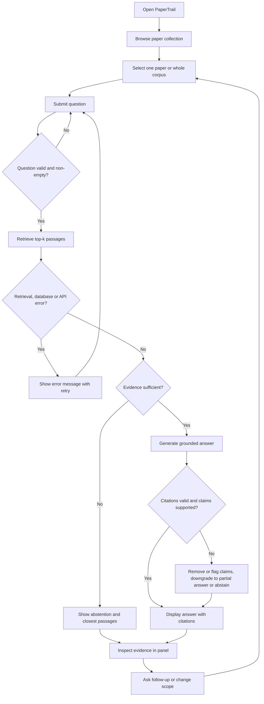

# PaperTrail: Product Requirements Document

An Evaluated Research-Paper Assistant · IoT Lab Society AI/ML Probationary Project · Version 1.0 · 29 October 2026 · Status: Draft for development

## Document Conventions and Source Note

Every statement that could be mistaken for a mandate carries one of three tags.

| Tag | Meaning |
| --- | --- |
| **\[OFFICIAL\]** | Stated as mandatory or as part of the assessment in the project brief, as relayed in the project request |
| **\[REC\]** | My recommendation, not mandated by the brief |
| **\[ASM\]** | An assumption that needs confirmation (listed in Supplement A) |

**Source note \[ASM-01\].** The official document, *Formal AI/ML Probationary Project Briefs* (pages 2, 10–11 and 24), was not attached to the request that produced this PRD. Official items below (the nine mandatory requirements, the stretch challenge, the 100-point rubric, the seven-day schedule and the submission checklist) are taken from the project request. Before submission, verify them line by line against the PDF. Page 2 general instructions are not reproduced here and must be checked separately.

**Product in one paragraph.** PaperTrail lets a student or researcher ask natural-language questions about a small, curated collection of research papers. It retrieves relevant passages first, then produces an answer that cites source and page, or it abstains when the papers do not contain sufficient evidence. It is an evaluated AI/ML system: retrieval quality, faithfulness, citation correctness and abstention are measured, and a lexical versus embedding retriever comparison is a planned stretch deliverable.

---

## 1. Problem Statement

Research papers are dense, long and unevenly structured. Finding a specific fact (a dataset size, an ablation result, a stated limitation) usually means opening several PDFs and skimming. Four problems follow.

1. **Inefficient information discovery.** Keyword search inside a PDF viewer misses paraphrases, and reading a whole paper to answer one question is slow. Readers working across several papers repeat this effort per paper.
2. **Unsupported LLM answers.** A general-purpose LLM asked about a paper may answer from memory, blend sources or invent details. The answer reads fluently whether or not the paper supports it.
3. **Unreliable citations.** Generated citations can point to the wrong paper, wrong page or a passage that does not say what is claimed. A citation that looks authoritative but is wrong is worse than none.
4. **Difficulty verifying responses.** Even a correct answer is hard to trust if the reader cannot see the exact supporting passage and page without re-reading the paper.

**Why evidence-grounded retrieval is necessary.** Retrieving passages before generation constrains the answer to documents the reader can inspect, and it makes the system's behaviour measurable: one can ask whether the right passage was found, whether the answer follows from it, and whether the citation points to it.

**Why abstention is necessary.** A corpus is finite. When a question falls outside it, or the evidence is weak, any fluent answer is by definition unsupported. A research tool must be able to say that the papers do not answer the question, and that behaviour must be evaluated, not assumed.

## 2. Goal

### 2.1 Primary goals

| ID | Goal | Status |
| --- | --- | --- |
| G1 | Answer questions about a curated paper collection using retrieved evidence, with source and page references wherever available | **\[OFFICIAL\]** mandatory |
| G2 | Abstain when retrieved evidence does not sufficiently support an answer | **\[OFFICIAL\]** mandatory (abstention is an assessed outcome) |
| G3 | Provide an interface to query documents and inspect supporting evidence | **\[OFFICIAL\]** mandatory |
| G4 | Measure retrieval quality, faithfulness, citation correctness and abstention on at least 25 questions including unanswerable ones | **\[OFFICIAL\]** mandatory |
| G5 | Compare at least two retrieval or chunking configurations under identical conditions | **\[OFFICIAL\]** mandatory |
| G6 | Deploy a working site on Vercel that does not rely on local filesystem persistence | Project constraint from the request |

### 2.2 Secondary goals

| ID | Goal | Status |
| --- | --- | --- |
| G7 | Compare lexical and embedding retrieval on the same corpus and questions, covering retrieval metrics, answer quality, citation quality, latency and cost, with measured results | **\[OFFICIAL\]** optional stretch; **committed by the team** |
| G8 | Add a hybrid retriever as an extra experiment | **\[REC\]** only if time permits |
| G9 | Systematic failure analysis with categorised error examples | Assessed under failure analysis; **\[REC\]** to treat as core work |
| G10 | Expose experiment results in the interface | **\[REC\]** Could Have |

### 2.3 Success indicators

Outcomes are separated into those the brief requires to exist and those I propose as quality targets. **No official numerical pass threshold is known \[ASM-02\]; the targets below are proposals for the team's own bar, to be reported honestly even if missed.**

| Indicator | Mandatory outcome \[OFFICIAL\] | Proposed target \[REC\] |
| --- | --- | --- |
| Evaluation set | At least 25 questions, including unanswerable ones | 30–40 questions, at least 25% unanswerable, each with gold evidence (paper and page) for answerable items |
| Retrieval quality | Measured | Report Recall@k and MRR per configuration; aim for Recall@5 of 0.70 or higher on answerable test questions for the best configuration |
| Faithfulness | Measured | At least 85% of generated claims judged supported by the cited passages |
| Citation correctness | Measured | At least 90% of emitted citations point to a retrieved passage that supports the claim; 0 citations to passages that were not retrieved |
| Abstention | Measured | Abstains on at least 80% of unanswerable questions while wrongly abstaining on no more than 20% of answerable ones |
| Configuration comparison | At least two configurations compared | At least two chunking configurations and two retrievers (lexical, embedding), run on identical data |
| Stretch comparison | Lexical versus embedding (or hybrid), with measurable results | Table covering retrieval metrics, answer faithfulness, citation correctness, latency and cost |
| Deployment | Site live on Vercel | Core query flow works from a clean browser with no local state |

### 2.4 Connection to assessment criteria

| Rubric criterion (points) | Goals that serve it |
| --- | --- |
| Corpus and ingestion quality (10) | G1, G6 |
| Retrieval implementation (20) | G1, G5, G7 |
| Grounded generation and citations (20) | G1 |
| Evaluation design and metrics (20) | G4, G5, G7 |
| Failure analysis and abstention (15) | G2, G9 |
| Demo and documentation (10) | G3, G6, G10 |
| Technical defence (5) | All; requires each team member's contribution to be demonstrable |

## 3. Target User

PaperTrail serves individual readers of academic papers. It deliberately has no administrator, team or enterprise personas.

### 3.1 Primary users

| User | Needs | Pain points | Typical workflow |
| --- | --- | --- | --- |
| **Student** (undergraduate or master's) reading papers for a course or project | Quickly locate definitions, methods, datasets and results; confirm understanding | Unfamiliar jargon, long papers, uncertainty about whether an AI answer is trustworthy | Opens a paper, skims the abstract, searches for a term, rereads sections; asks a chatbot and doubts it |
| **Early-stage researcher** doing a literature review | Compare how several papers describe a method or result; extract reported numbers with page references to cite | Re-reading to find one number; chatbots that fabricate citations | Collects PDFs, extracts notes by hand, maintains a comparison table |
| **Academic reader or reviewer** verifying a claim | See the exact supporting passage, not a summary | Summaries without traceable evidence | Checks a claim against the source page before relying on it |

### 3.2 Common needs

- Ask in plain language and get a short answer with visible evidence.
- Know when the system does not know.
- Verify a citation in one click.
- Limit questions to one paper or search all papers.

### 3.3 Secondary audience

The project assessors and mentors review the product, repository and evaluation. They are not product users, but the interface must make system behaviour (retrieved passages, abstentions, configuration used) legible to them in a demo.

## 4. User Stories

Priority key: **Must** = Must Have, **Should** = Should Have, **Could** = Could Have. Requirement IDs are defined in Section 5.

| ID | Story | Priority | Requirements |
| --- | --- | --- | --- |
| US-01 | As a student, I want to see which papers are in the collection with title, authors and year, so that I know what I can ask about. | Must | FR-COL-02, FR-UI-01 |
| US-02 | As a researcher, I want to open a paper's details and link to its original source, so that I can confirm the document is the one I intend. | Should | FR-COL-02, FR-COL-03, FR-UI-01 |
| US-03 | As a student, I want to restrict my question to one selected paper or search the whole collection, so that answers match my focus. | Must | FR-RET-03, FR-UI-02 |
| US-04 | As a student, I want to type a question in natural language, so that I do not need to craft keyword queries. | Must | FR-UI-03 |
| US-05 | As a researcher, I want a concise answer grounded in the papers, so that I save time over reading whole documents. | Must | FR-GEN-01, FR-GEN-04 |
| US-06 | As a researcher, I want each claim to carry a citation with paper and page, so that I can cite or verify it. | Must | FR-GEN-02, FR-CIT-01, FR-UI-04 |
| US-07 | As an academic reader, I want to click a citation and see the exact supporting passage in context, so that I can verify it myself. | Must | FR-CIT-04, FR-CIT-05, FR-UI-05 |
| US-08 | As a reader, I want to see all retrieved passages, including those not cited, so that I can judge whether the system chose well. | Should | FR-RET-03, FR-UI-05 |
| US-09 | As a student, I want the system to say clearly when the papers do not contain the answer, so that I am not misled. | Must | FR-ABS-01, FR-ABS-02, FR-UI-06 |
| US-10 | As a student, I want to see the closest passages even when it abstains, so that I can see why it could not answer. | Should | FR-ABS-02, FR-UI-06 |
| US-11 | As a researcher, I want to be told when only part of my question is supported, so that I know which part to trust. | Should | FR-GEN-05, FR-ABS-04 |
| US-12 | As a researcher, I want to be shown when papers disagree, so that conflicting evidence is not silently merged. | Should | FR-GEN-06 |
| US-13 | As a reader, I want to know when a page number is unavailable, so that I do not cite the wrong page. | Should | FR-CIT-06 |
| US-14 | As a reader, I want clear messages when something fails (service error, no results), so that I can retry or rephrase. | Must | FR-UI-07 |
| US-15 | As an assessor, I want to view evaluation results for each configuration, so that I can see the evidence for the team's claims. | Could | FR-EVL-07, FR-EVL-08, FR-UI-09 |
| US-16 | As an assessor, I want to switch between lexical and embedding retrieval on the same question, so that I can see their differences in a demo. | Should | FR-RET-04, FR-UI-08 |
| US-17 | As a reader on a phone or using a keyboard or screen reader, I want to use the core flow, so that the tool is accessible. | Should | FR-UI-10 |
| US-18 | As a reader, I want a visible note on limitations (small corpus, possible errors), so that I calibrate trust. | Should | FR-UI-11 |

## 5. Functional Requirements

Priority uses MoSCoW: **Must** (needed for the official deliverables), **Should** (strongly recommended), **Could** (only if time permits). Each requirement is stated once here; later sections refer to these IDs rather than restating them.

### 5.1 Research-Paper Collection and Metadata (FR-COL)

| ID | Description | Priority | Expected behaviour | Inputs / Outputs | Dependencies | Verification |
| --- | --- | --- | --- | --- | --- | --- |
| FR-COL-01 | Curated corpus of publicly accessible or approved papers \[OFFICIAL\] | Must | Corpus has a coherent topic and enough overlap to support cross-paper and unanswerable questions. Recommended size: 10–15 papers \[ASM-03\] | In: paper selection. Out: list of source PDFs | None | Corpus manifest lists every paper; each is publicly accessible or approved |
| FR-COL-02 | Metadata record per paper | Must | Title, authors, year and source URL stored; missing fields shown as unknown, never guessed | In: PDF and manifest. Out: metadata record | FR-COL-01 | Every paper has a record; missing fields are visibly marked |
| FR-COL-03 | Provenance and licence note | Should | Each paper records where it was obtained and its licence or permission basis | In: manifest. Out: provenance field | FR-COL-01 | Every manifest entry has a source link and licence note |
| FR-COL-04 | Versioned corpus manifest | Must | A manifest fixes the exact papers, file checksums and corpus version used in experiments | In: PDFs. Out: manifest with checksums | FR-COL-01 | Rerunning ingestion from the manifest yields the same document set |

### 5.2 Document Ingestion and Text Extraction (FR-ING)

| ID | Description | Priority | Expected behaviour | Inputs / Outputs | Dependencies | Verification |
| --- | --- | --- | --- | --- | --- | --- |
| FR-ING-01 | Parse PDFs into page-level text \[OFFICIAL\] | Must | Text is extracted per page with page numbers preserved | In: PDF. Out: per-page text | FR-COL-04 | Spot check of at least 5 papers: extracted text and page numbers match the PDF |
| FR-ING-02 | Ingestion separated from user requests | Must | Ingestion is an offline or admin-triggered job; normal queries never trigger parsing | In: manifest. Out: stored text, chunks, indexes | FR-ING-01 | Query path runs with ingestion code unavailable |
| FR-ING-03 | Repeatable ingestion | Must | Running ingestion twice on the same manifest produces the same documents and chunk IDs without duplicates | In: manifest. Out: stable stored records | FR-ING-01, FR-CHK-04 | Two runs produce identical IDs and counts |
| FR-ING-04 | Ingestion report with failure detection | Must | Empty, corrupted, scanned (no text layer) or low-text PDFs are detected, reported and excluded or flagged, never silently indexed | In: parse results. Out: per-paper status report | FR-ING-01 | Test files for each failure type appear in the report with the right status |
| FR-ING-05 | Duplicate detection | Should | Identical or near-identical documents are identified; only one is indexed or the duplicate is flagged | In: manifest and text. Out: duplicate flag | FR-COL-04 | A deliberately duplicated PDF is flagged |
| FR-ING-06 | Extraction quality notes | Should | Pages with tables, equations or multi-column layout that extract poorly are noted | In: parse results. Out: per-page quality flags | FR-ING-01 | Known complex pages carry flags |

### 5.3 Chunking and Source Tracking (FR-CHK)

| ID | Description | Priority | Expected behaviour | Inputs / Outputs | Dependencies | Verification |
| --- | --- | --- | --- | --- | --- | --- |
| FR-CHK-01 | Divide text into retrievable chunks \[OFFICIAL\] | Must | Each chunk is a coherent span of text from one paper | In: page text. Out: chunks | FR-ING-01 | Sampled chunks are readable and contained in a single paper |
| FR-CHK-02 | Source tracking on every chunk | Must | Each chunk records paper, start page and end page (if it spans pages), and position in the document; section heading where detectable | In: chunks. Out: chunk metadata | FR-CHK-01 | 100% of chunks have paper and page; sampled page numbers match the PDF |
| FR-CHK-03 | At least two chunking configurations | Must | Two parameterised configurations (e.g. different size or overlap) can be generated from the same text \[OFFICIAL: two configurations compared\] | In: config parameters. Out: two chunk sets | FR-CHK-01 | Both sets exist, are labelled, and differ only in the declared parameters |
| FR-CHK-04 | Deterministic chunk identifiers | Must | The same text and configuration always give the same IDs | In: text, config. Out: stable IDs | FR-CHK-01 | Rerun check |
| FR-CHK-05 | Handling of non-prose content | Should | References lists, tables and formulas are either flagged or handled consistently, and the chosen policy is documented | In: page text. Out: flags or exclusions | FR-ING-06 | Policy applied to sampled pages and documented |

### 5.4 Lexical and Embedding-Based Retrieval (FR-RET)

| ID | Description | Priority | Expected behaviour | Inputs / Outputs | Dependencies | Verification |
| --- | --- | --- | --- | --- | --- | --- |
| FR-RET-01 | Lexical retriever \[OFFICIAL: lexical or embedding\] | Must | Returns top-k chunks ranked by keyword match | In: query, k, scope. Out: ranked chunks with scores | FR-CHK-02 | Known keyword questions retrieve the expected chunk |
| FR-RET-02 | Embedding retriever | Must | Returns top-k chunks ranked by semantic similarity. Required because the team committed to the stretch challenge | In: query, k, scope. Out: ranked chunks with scores | FR-CHK-02 | Paraphrased questions retrieve the expected chunk |
| FR-RET-03 | Scoped retrieval and evidence output | Must | Retrieval can be limited to one paper or the whole corpus; every result carries chunk ID, paper, page and score | In: query, scope. Out: structured results | FR-RET-01, FR-RET-02 | A single-paper query returns chunks only from that paper |
| FR-RET-04 | Selectable retriever mode | Should | A user or evaluator can choose lexical or embedding for a query for demonstration | In: mode flag. Out: results from the chosen retriever | FR-RET-01, FR-RET-02 | Same question returns different rankings per mode, and the mode is displayed |
| FR-RET-05 | Identical experimental conditions | Must | Retrievers are compared on the same corpus, chunks, questions, k and generation settings | In: experiment config. Out: comparable runs | FR-EVL-07 | Config files differ only in the retriever |
| FR-RET-06 | Latency and cost recording | Must (stretch) | Each retrieval run records latency, and embedding or LLM usage cost | In: run. Out: timing and cost log | FR-RET-05 | Log exists for every evaluation run |
| FR-RET-07 | Hybrid retriever | Could | Combines lexical and embedding scores as an additional experiment | In: query. Out: ranked chunks | FR-RET-01, FR-RET-02 | If built, reported in the same comparison table |
| FR-RET-08 | Retrieval confidence signal | Must | Retrieval returns scores usable by the sufficiency check; an empty result is a valid outcome | In: query. Out: scores or empty result | FR-ABS-01 | Nonsense queries return low scores or nothing |

### 5.5 Grounded Answer Generation (FR-GEN)

| ID | Description | Priority | Expected behaviour | Inputs / Outputs | Dependencies | Verification |
| --- | --- | --- | --- | --- | --- | --- |
| FR-GEN-01 | Answers grounded in retrieved evidence \[OFFICIAL\] | Must | The answer uses only retrieved passages; no outside knowledge presented as fact | In: question, retrieved chunks. Out: answer text | FR-RET-03 | Faithfulness evaluation (FR-EVL-04); manual review of sampled answers |
| FR-GEN-02 | Source and page references \[OFFICIAL\] | Must | Each substantive claim carries a citation identifying paper and page, or an explicit note that the page is unavailable | In: answer. Out: citations linked to chunk IDs | FR-CHK-02 | Every non-abstained answer has at least one citation; each resolves to a stored chunk |
| FR-GEN-03 | Server-side model access | Must | The language model is called only from the server; credentials never reach the browser | In: request. Out: response | None | Inspection of client bundle and network traffic shows no credential |
| FR-GEN-04 | Structured result | Must | Each response has a status (answered, partial, abstained, error), answer text, and citations | In: pipeline output. Out: typed result | FR-GEN-01 | Every response conforms to the structure |
| FR-GEN-05 | Partial support disclosure | Should | When only part of the question is supported, the answer covers the supported part and states what is missing | In: question, evidence. Out: partial answer | FR-ABS-04 | Test questions with a supported and an unsupported part |
| FR-GEN-06 | Conflicting evidence disclosure | Should | When papers disagree, the answer presents each position with its own citation and does not merge them | In: evidence. Out: answer with attributed positions | FR-GEN-01 | Seeded conflicting-evidence questions |
| FR-GEN-07 | Concise, readable answers | Should | Answers are short, in plain language, and quote technical terms as written in the papers | In: evidence. Out: answer text | FR-GEN-01 | Reviewer read-through |

### 5.6 Citation Validation and Evidence Inspection (FR-CIT)

| ID | Description | Priority | Expected behaviour | Inputs / Outputs | Dependencies | Verification |
| --- | --- | --- | --- | --- | --- | --- |
| FR-CIT-01 | Structural citation validation | Must | Every citation must refer to a chunk that was actually retrieved for this query; others are removed or the answer is flagged | In: answer with citations, retrieved set. Out: validated citations | FR-GEN-02 | Injected fake citation is rejected |
| FR-CIT-02 | Claim-to-evidence support check | Should | Claims are checked against their cited passages; unsupported claims are removed or flagged | In: claims, passages. Out: support label per claim | FR-CIT-01 | Seeded unsupported claim is flagged |
| FR-CIT-03 | Invalid citation handling | Must | If validation removes all support, the response becomes an abstention or an explicit warning, not a confident answer | In: validation result. Out: updated status | FR-CIT-01 | Test with all citations invalid |
| FR-CIT-04 | Evidence display | Must | Cited passages appear with full text, paper title, and page | In: validated citations. Out: evidence cards | FR-CHK-02 | Each citation opens its passage |
| FR-CIT-05 | Citation-to-evidence linking | Must | Selecting a citation marker brings up and highlights the matching passage | In: citation id. Out: highlighted passage | FR-CIT-04 | Interaction test on desktop and mobile |
| FR-CIT-06 | Missing page handling | Should | If no page can be determined, the citation says so and still names the paper and passage | In: chunk with no page. Out: labelled citation | FR-CHK-02 | Chunk with removed page metadata displays the notice |

### 5.7 Abstention (FR-ABS)

| ID | Description | Priority | Expected behaviour | Inputs / Outputs | Dependencies | Verification |
| --- | --- | --- | --- | --- | --- | --- |
| FR-ABS-01 | Evidence sufficiency assessment | Must | Before answering, the system judges whether retrieved evidence suffices, using retrieval scores and a generation-time check | In: scores, chunks. Out: sufficient or insufficient | FR-RET-08 | Evaluated on answerable and unanswerable questions |
| FR-ABS-02 | Abstention response | Must | If insufficient, the system states that the papers do not contain enough evidence, gives the reason category, and offers closest passages optionally | In: assessment. Out: abstained result | FR-GEN-04 | Unanswerable test questions produce no fabricated answer |
| FR-ABS-03 | Calibration without leakage | Must | Thresholds are tuned only on development questions and reported on held-out test questions | In: dev set. Out: threshold values | FR-EVL-02 | Thresholds file references dev set only |
| FR-ABS-04 | Distinct abstention categories | Should | Out-of-corpus, insufficient evidence, ambiguous question, and partial support are distinguished in the result | In: assessment. Out: category | FR-ABS-01 | Each category has at least one test case |
| FR-ABS-05 | Abstention logging | Should | Abstentions are logged with category and scores for failure analysis | In: result. Out: log entry | FR-ABS-02 | Log contains all evaluation abstentions |

### 5.8 Evaluation Framework (FR-EVL)

| ID | Description | Priority | Expected behaviour | Inputs / Outputs | Dependencies | Verification |
| --- | --- | --- | --- | --- | --- | --- |
| FR-EVL-01 | Evaluation dataset \[OFFICIAL: at least 25 questions incl. unanswerable\] | Must | Dataset has at least 25 questions (recommended 30–40), each with type, gold answer, and gold evidence (paper, page) where answerable; unanswerable items are marked. Recommended mix: factual lookup, multi-sentence explanation, cross-paper comparison, unanswerable | In: corpus. Out: dataset file | FR-COL-04 | Count, labelling, and unanswerable proportion verified by script |
| FR-EVL-02 | Leakage prevention | Must | Questions are split into development (used for tuning) and held-out test; no tuning on test items; questions do not copy chunk text verbatim \[REC\] | In: dataset. Out: split | FR-EVL-01 | Split file and tuning log |
| FR-EVL-03 | Retrieval metrics \[OFFICIAL: retrieval quality\] | Must | Recall@k, hit rate and MRR computed against gold evidence per configuration | In: gold evidence, ranked results. Out: metrics | FR-EVL-01 | Metrics reproduce from stored runs |
| FR-EVL-04 | Faithfulness evaluation \[OFFICIAL\] | Must | Claims in answers are labelled supported or unsupported by retrieved evidence; method (human, model-assisted, or both) is documented | In: answers, evidence. Out: faithfulness score | FR-GEN-01 | Scores plus manual review sample |
| FR-EVL-05 | Citation correctness evaluation \[OFFICIAL\] | Must | Each citation is checked: exists in retrieved set, points to the right paper and page, and supports the claim | In: answers. Out: citation precision | FR-CIT-01 | Scores plus manual review sample |
| FR-EVL-06 | Abstention evaluation \[OFFICIAL\] | Must | Reports abstention rate on unanswerable questions, wrongful abstention on answerable ones, and unsupported-answer rate | In: results. Out: abstention metrics | FR-ABS-02 | Confusion table by question type |
| FR-EVL-07 | Configuration comparison \[OFFICIAL\] | Must | At least two retrieval or chunking configurations are run on the same corpus and questions and compared on all metrics | In: configs. Out: comparison table | FR-CHK-03, FR-EVL-03 to 06 | Table with at least two configurations |
| FR-EVL-08 | Lexical versus embedding comparison \[OFFICIAL stretch; committed\] | Must | Both retrievers evaluated under identical conditions for retrieval metrics, answer faithfulness, citation correctness, latency and cost; results are measured, not described | In: configs. Out: stretch results table | FR-RET-05, FR-RET-06 | Results file with all five measures for both retrievers |
| FR-EVL-09 | Reproducible Python workflow | Must | Evaluation runs from documented commands with pinned dependencies and fixed settings; outputs saved | In: dataset, configs. Out: result files | FR-ING-03 | A clean checkout reproduces the reported tables within stated tolerance for model randomness |
| FR-EVL-10 | Failure analysis | Must | Failures are categorised (retrieval miss, bad chunking, unsupported claim, bad citation, wrongful abstention, wrongful answer) with examples and causes | In: results. Out: analysis document | FR-EVL-03 to 06 | Document with categorised examples and counts |
| FR-EVL-11 | Validation of automated judging | Should | If a model judges faithfulness or citations, a manual sample checks agreement | In: judged sample. Out: agreement figure | FR-EVL-04 | Sample and agreement reported |

### 5.9 User Interface (FR-UI)

| ID | Description | Priority | Expected behaviour | Inputs / Outputs | Dependencies | Verification |
| --- | --- | --- | --- | --- | --- | --- |
| FR-UI-01 | Collection view | Must | Lists papers with title, authors, year and source link | In: metadata. Out: list | FR-COL-02 | All corpus papers shown |
| FR-UI-02 | Scope selection | Must | User chooses one paper or the whole corpus before asking | In: selection. Out: scope | FR-RET-03 | Scope is visible and respected |
| FR-UI-03 | Question input | Must | A single input accepts a natural-language question; empty input is rejected politely | In: text. Out: submitted query | None | Manual test |
| FR-UI-04 | Answer view | Must | Answer shows status, text and inline citation markers | In: result. Out: rendered answer | FR-GEN-04 | Manual test |
| FR-UI-05 | Evidence panel | Must | Shows cited passages (and retrieved but uncited passages as a secondary list) with paper, page and score | In: result. Out: evidence cards | FR-CIT-04 | Manual test |
| FR-UI-06 | Abstention view | Must | Abstention is visually distinct from an answer and explains why | In: abstained result. Out: message | FR-ABS-02 | Manual test with unanswerable question |
| FR-UI-07 | Loading, empty and error states | Must | Shows progress, no-result and failure messages with retry | In: states. Out: messages | FR-GEN-04 | Simulated failures |
| FR-UI-08 | Retriever mode control | Should | Lets an evaluator pick lexical or embedding retrieval, and shows which was used | In: mode. Out: labelled result | FR-RET-04 | Manual test |
| FR-UI-09 | Evaluation results page | Could | Shows the comparison tables from FR-EVL-07 and FR-EVL-08 | In: result files. Out: page | FR-EVL-08 | Page matches saved results |
| FR-UI-10 | Accessibility and responsiveness | Should | Core flow works by keyboard and on narrow screens (see Section 6) | n/a | All UI | Checklist in Section 11 |
| FR-UI-11 | Limitations notice | Should | A concise note states corpus scope and that answers can be wrong | n/a | None | Visible on main screen |

---

## 6. Non-Functional Requirements

The project brief sets no numerical performance requirements \[ASM-02\]. Items marked **Proposed** are targets I recommend, not official mandates, and they are not guarantees.

| Area | Requirement | Type |
| --- | --- | --- |
| Reliability | The deployed site must remain functional after deployment and must not depend on local filesystem persistence | Project constraint |
| Reliability | Failures of the database, network or model provider produce a clear message and never a fabricated answer | Required behaviour (FR-UI-07) |
| Reliability | Corpus data persists between deployments and requests | Project constraint |
| Performance | Retrieval-only responses feel interactive; end-to-end answers target under about 15 seconds for typical questions, with visible progress | **Proposed** |
| Performance | Latency and cost per retriever are measured and reported, not just targeted | Required for stretch |
| Scalability | Designed for a small corpus (about 10–15 papers, hundreds to a few thousand chunks). Large-scale scaling is not a goal | **Proposed** |
| Maintainability | Code, configuration and experiments are organised so a teammate can run and extend them from the README | **Proposed** |
| Reproducibility | Pinned dependencies, fixed experiment settings, saved raw outputs, and documented commands for ingestion and evaluation | Checklist item (reproducible code, dependencies) |
| Security | Credentials are held server-side only and never appear in the repository or client | Project constraint |
| Security | The public query endpoint has basic abuse limits so API spend stays bounded | **Proposed** |
| Privacy | No personal user data is required; queries are logged only as needed for evaluation and are disclosed | **Proposed** |
| Accessibility | Keyboard navigable, sufficient colour contrast (target WCAG 2.1 AA), semantic structure, visible focus, and non-colour cues for answer versus abstention | **Proposed** |
| Responsiveness | Core flow works from phone width to desktop width | **Proposed** |
| Cost | Total model and storage spend stays within free or low-cost tiers where possible; spend is tracked per experiment | **Proposed** |

---

## 7. User Flow

### 7.1 Primary journey

| Step | User action | System behaviour | Requirements |
| --- | --- | --- | --- |
| 1 | Opens PaperTrail | Loads the collection view and a short limitations note | FR-UI-01, FR-UI-11 |
| 2 | Explores available papers | Shows title, authors, year and source link for each paper | FR-COL-02, FR-UI-01 |
| 3 | Selects one paper or the whole corpus | Shows the active scope clearly | FR-UI-02 |
| 4 | Submits a question | Validates non-empty input and shows progress | FR-UI-03, FR-UI-07 |
| 5 | (system) Retrieval | Retrieves top-k passages within the scope | FR-RET-01 to FR-RET-03 |
| 6 | (system) Sufficiency check | Judges whether the evidence supports an answer | FR-ABS-01 |
| 7 | (system) Generate or abstain | Produces a grounded answer, a partial answer, or an abstention | FR-GEN-01, FR-ABS-02 |
| 8 | Reads the response | Displays citations with paper and page | FR-GEN-02, FR-CIT-01, FR-UI-04 |
| 9 | Inspects evidence | Opens the cited passage in the evidence panel; browses other retrieved passages | FR-CIT-04, FR-CIT-05, FR-UI-05 |

### 7.2 Flow diagram

### 7.3 Alternative and failure flows

| Situation | What the user experiences |
| --- | --- |
| **Parsing failure** (ingestion time) | Users never see parsing. A paper that failed ingestion is excluded or shown with a notice that it is not searchable, and the ingestion report records why (FR-ING-04) |
| **Retrieval failure** (no relevant passages) | An abstention explains that nothing relevant was found, optionally with the closest passages, and suggests rephrasing or widening scope |
| **Weak retrieval** (low scores) | Treated as insufficient evidence: abstention rather than a guess |
| **API error or timeout** | Error message that distinguishes service failure from no-evidence; retry control; no answer is fabricated |
| **Unanswerable or unrelated question** | Abstention stating the collection does not cover it; no general-knowledge answer |
| **Invalid citations after generation** | The unsupported claims are removed or flagged; if nothing supported remains, the response becomes an abstention |

## 8. Design Requirements

### 8.1 Visual direction

PaperTrail should feel like a quiet scholarly reading desk: closer to a reference manager or journal reader than a chat app. The main idea is a **two-column workspace**: the question and answer on the left, the source evidence on the right, so the reader can always compare a claim with its source.

Design principles, in priority order:

1. **Readability first.** Long-form reading comfort over decoration.
2. **Answer and evidence are visually distinct.** The generated answer is one visual layer; verbatim source text is another, with different typography and background, so a reader never mistakes generated text for quoted text.
3. **Citations are first-class.** Each marker is a large enough, keyboard-reachable control.
4. **Evidence inspection takes one action.**
5. **Minimal clutter.** No chat bubbles, avatars or decorative imagery.

### 8.2 Typography and colour \[REC\]

| Element | Recommendation |
| --- | --- |
| Source passages and paper titles | A serif face suited to long reading (for example Source Serif or Newsreader), 16–18 px, line height about 1.6, line length 60–75 characters |
| Interface, answers and controls | A clean sans-serif (for example Inter or IBM Plex Sans), 15–16 px body |
| Metadata, scores, page labels | A smaller or monospaced face, used sparingly |
| Palette | Warm off-white page, near-black text, one restrained accent (deep blue or teal) for citations and links |
| Status colours | Answer: neutral with accent citations; Partial: amber tint with text label; Abstained: a muted grey-blue panel with text label; Error: red tint with text label. Status is always conveyed by text and icon, not colour alone |
| Dark theme | Optional (Could); if built it must keep contrast targets |

Final font and colour choices are design decisions to be confirmed in the TRD or design pass \[ASM-04\].

### 8.3 Information architecture and page hierarchy

| Level | Screen | Purpose |
| --- | --- | --- |
| 1 | **Workspace (home)** | Collection sidebar, question input, answer and evidence panel. The main product surface |
| 2 | **Paper detail** (drawer or page) | Metadata, source link, ingestion status for one paper |
| 2 | **Evaluation results** (Could) | Comparison tables and failure categories |
| 2 | **About and limitations** | Corpus description, method summary, known limitations |

### 8.4 Screens and key components

| Screen | Key components |
| --- | --- |
| **Workspace, idle** | Left: paper list with scope toggle (All papers or selected paper) and search or filter. Centre: question input with example questions drawn from the corpus. Right: empty evidence panel with short guidance |
| **Workspace, loading** | Progress indicator naming the stage (searching papers, composing answer); input disabled; cancel control |
| **Workspace, answered** | Answer card with status label and inline numbered citation markers; reference list under the answer (paper, page); evidence panel listing cited passages first, then other retrieved passages; each passage shows paper title, page, text, and retrieval score (collapsible) |
| **Workspace, abstained** | Distinct abstention card: clear statement, reason category, suggestions to rephrase, and an expandable list of closest passages |
| **Workspace, error** | Inline error card with retry; the previous result stays visible |
| **Evidence inspection** | Selecting a citation scrolls to and highlights its passage; the passage can expand to show surrounding text and the page label; link to the original paper source |
| **Paper detail** | Title, authors, year, source link, licence note, indexed status |
| **Evaluation results** (Could) | Table per configuration; lexical versus embedding comparison; failure-category summary |

### 8.5 Layout and responsive behaviour

- **Desktop (wide):** three regions: collection sidebar (narrow), answer column, evidence panel.
- **Tablet:** sidebar collapses into a drawer; answer and evidence stay side by side if width allows, otherwise stacked.
- **Phone:** single column. Answer first, citation markers open the evidence as a bottom sheet or inline expansion; scope selector is a compact control above the input.
- No horizontal page scrolling at any width; long passages wrap.
- Touch targets are at least 44 px; keyboard focus order follows reading order (scope, question, answer, citations, evidence).

### 8.6 Accessibility basics

Semantic headings and landmarks; labelled form controls; focus management when evidence opens; live-region announcement for loading, answer and abstention; contrast target WCAG 2.1 AA \[REC\]; respect reduced-motion preferences.

## 9. Technical Constraints

These are product-level constraints. Detailed technology choices, schemas and API contracts belong to the TRD.

| Constraint | Product implication |
| --- | --- |
| **Vercel deployment** \[project requirement\] | The product must be a deployed website reachable by URL; it must work from a clean browser with no installation |
| **Serverless execution** | Requests are short-lived and stateless; no background process can be assumed between requests; execution time and memory are limited, so heavy work (PDF parsing, embedding the corpus) cannot happen on the normal user path |
| **No local filesystem persistence** \[project requirement\] | Anything needed after deployment (documents, chunks, indexes, metadata) must live in external storage, not on disk |
| **External persistence** | A hosted database and document or object storage are needed. Their free-tier limits and availability become product constraints |
| **Ingestion separated from user requests** | Ingestion and indexing are offline or administrator-triggered jobs; the deployed site only reads their results |
| **Python-based ML and evaluation** | Parsing, embedding, evaluation and analysis are Python workflows; the web app and Python workflows must share the same corpus, chunking configuration and identifiers so results from local runs describe what is deployed |
| **Local and production compatibility** | The same configuration must run locally and in production, with environment-specific values (credentials, endpoints) kept out of code |
| **AI provider dependencies** | Answer generation and embedding depend on an external provider: rate limits, cost, latency, model changes and outages affect the product. Model identifiers and versions must be recorded for each experiment |
| **API key security** | Provider and database credentials exist only server-side and in deployment secrets; never in the repository, client bundle or logs |
| **Cold starts and latency** | First requests after idle time may be slower; the interface must tolerate this with progress feedback |
| **Corpus licensing** | Only papers that are publicly accessible or approved may be ingested; redistribution of full PDFs should respect each paper's licence |

---

## 10. Edge Cases

| ID | Case | Expected product behaviour |
| --- | --- | --- |
| EC-01 | Unanswerable question (about the field, but not in the corpus) | Abstain with category out-of-corpus; show closest passages if any; never answer from model memory |
| EC-02 | Unrelated question (e.g. everyday trivia) | Abstain, state that PaperTrail answers only from the loaded papers, offer example questions |
| EC-03 | Partially supported question | Answer only the supported part with citations, state explicitly what could not be found; status Partial |
| EC-04 | Conflicting information across papers | Present each position separately with its own citation and paper; do not pick a winner unless a paper itself does; flag that sources differ |
| EC-05 | Ambiguous question (unclear term, paper or metric) | Ask the user to clarify or state the interpretation used; if evidence supports several interpretations, answer each separately; otherwise abstain with category ambiguous |
| EC-06 | Duplicate documents (same paper, different versions or files) | Detect at ingestion; index one canonical copy, record the duplicate in the report; never show the same passage twice as separate evidence |
| EC-07 | Missing metadata (title, authors, year) | Display unknown rather than guessing; still searchable; log in ingestion report |
| EC-08 | Missing page references | Cite paper and passage with a clear page unavailable label; never invent a page |
| EC-09 | Empty PDF | Excluded from the index; reported in the ingestion report; not listed as searchable |
| EC-10 | Corrupted PDF | Ingestion fails safely for that file only, other papers proceed; failure logged; no partial indexing |
| EC-11 | Scanned PDF (no text layer) | Detected by near-zero extracted text; flagged unsupported; excluded from the corpus. OCR is not required \[ASM-05\] |
| EC-12 | Complex layouts (multi-column, headers, footers) | Text order may degrade; affected pages flagged; failures counted in failure analysis |
| EC-13 | Tables and mathematical notation | Extraction is best effort. Answers must not assert numbers from a table unless the extracted passage clearly contains them; otherwise treat as insufficient evidence and point to the page |
| EC-14 | Irrelevant retrieval results | Low-score or off-topic passages trigger insufficient evidence; they are shown only as the closest passages, labelled low relevance, never used for claims |
| EC-15 | Unsupported claim in an LLM answer | Detected by citation or support check; claim removed or flagged; status downgraded if needed |
| EC-16 | Invalid citation (not in retrieved set, wrong paper, wrong page) | Citation removed or flagged; the answer is not shown as fully verified; logged for evaluation |
| EC-17 | Database failure | Clear error message with retry; no cached stale answer presented as fresh; no fabricated response |
| EC-18 | Network failure on the client | Offline or connection message, input preserved |
| EC-19 | LLM or embedding provider failure, rate limit or timeout | Clear service-unavailable message distinct from abstention; retry; optional fallback to showing retrieved passages without a generated answer \[REC\] |
| EC-20 | Very long or empty question | Empty is rejected politely; very long input is trimmed or rejected with a message |
| EC-21 | Prompt injection inside a paper or in the question | Passage text and user text are treated as data, not instructions; behaviour must not change; noted as a known risk |

## 11. Acceptance Criteria

The brief gives no official numerical pass threshold \[ASM-02\]. Criteria below are testable conditions. Numbers marked **Proposed** are the team's own targets, not official.

| ID | Area | Acceptance criterion |
| --- | --- | --- |
| AC-01 | Corpus | Manifest lists all papers with source link, licence note, and checksum; every paper is publicly accessible or approved |
| AC-02 | Ingestion | Running ingestion twice from the manifest gives identical document and chunk counts and IDs; ingestion code is not invoked by any user request |
| AC-03 | Ingestion failures | Test files (empty, corrupted, scanned, duplicate) each appear in the ingestion report with the correct status, and none enters the index silently |
| AC-04 | Chunking | 100% of chunks have paper and page metadata; a manual sample of at least 20 chunks matches the PDF pages; at least two chunking configurations exist and are labelled |
| AC-05 | Lexical retrieval | Returns ranked top-k chunks with scores for any query within scope; documented example queries retrieve the expected chunk |
| AC-06 | Embedding retrieval | Same interface and output shape as lexical retrieval; paraphrase test queries retrieve expected chunks |
| AC-07 | Scoped retrieval | A single-paper query returns results from only that paper |
| AC-08 | Grounded generation | On the test set, no answered response relies on content absent from retrieved passages beyond what the faithfulness evaluation reports; every non-abstained response includes at least one citation |
| AC-09 | Citations | 100% of displayed citations refer to a chunk in the retrieved set; each shows paper and page or an explicit unavailable label; citation correctness is measured. **Proposed:** at least 90% precision |
| AC-10 | Abstention | Unanswerable evaluation questions are measured for abstention; abstention thresholds are set on development questions only. **Proposed:** at least 80% correct abstention and at most 20% wrongful abstention |
| AC-11 | Evaluation dataset | At least 25 questions, including unanswerable ones, with labelled type, gold answer and gold evidence (paper and page) for answerable items; development and test split recorded |
| AC-12 | Evaluation metrics | Reported results include retrieval quality, answer faithfulness, citation correctness and abstention for every evaluated configuration, produced by documented scripts |
| AC-13 | Configuration comparison | At least two configurations are evaluated on identical corpus, questions and settings; the comparison table is in the repository and documentation |
| AC-14 | Lexical versus embedding (stretch) | Both retrievers evaluated; table contains retrieval metrics, faithfulness, citation correctness, latency and cost for each; interpretation names the winner per measure or states no clear difference |
| AC-15 | Failure analysis | Documented analysis with categorised failure examples, counts, probable causes and limitations |
| AC-16 | Evidence inspection | Selecting a citation displays and highlights the supporting passage with paper title and page; uncited retrieved passages are viewable |
| AC-17 | Abstention interface | An unanswerable demo question yields a visibly distinct abstention state with an explanation and no unsupported answer |
| AC-18 | Error handling | Simulated database failure and provider failure each show a clear error, with no fabricated answer |
| AC-19 | Vercel deployment | A public Vercel URL loads, lists papers, answers a sample question with citations, and abstains on an unanswerable sample, with no dependency on local files; secrets absent from repository and client |
| AC-20 | Responsiveness and accessibility | Core flow works at phone and desktop widths and by keyboard only; automated accessibility check shows no critical violations. **Proposed** |
| AC-21 | Reproducibility | A fresh clone with documented setup reproduces the evaluation tables within stated tolerance for model variation |

### Requirements-to-Acceptance Traceability

| Requirement group | Requirements | Acceptance criteria |
| --- | --- | --- |
| Collection and metadata | FR-COL-01 to 04 | AC-01 |
| Ingestion and extraction | FR-ING-01 to 06 | AC-02, AC-03 |
| Chunking and source tracking | FR-CHK-01 to 05 | AC-04 |
| Lexical retrieval | FR-RET-01, 03, 08 | AC-05, AC-07 |
| Embedding retrieval | FR-RET-02, 03 | AC-06, AC-07 |
| Retriever comparison | FR-RET-04 to 07, FR-EVL-07, 08 | AC-13, AC-14 |
| Grounded generation | FR-GEN-01 to 07 | AC-08 |
| Citations and evidence | FR-CIT-01 to 06, FR-UI-05 | AC-09, AC-16 |
| Abstention | FR-ABS-01 to 05, FR-UI-06 | AC-10, AC-17 |
| Evaluation dataset and metrics | FR-EVL-01 to 06, 09, 11 | AC-11, AC-12, AC-21 |
| Failure analysis | FR-EVL-10 | AC-15 |
| User interface | FR-UI-01 to 11 | AC-16, AC-17, AC-18, AC-20 |
| Deployment and non-functional | Section 6 and 9 constraints | AC-18, AC-19, AC-20, AC-21 |

## 12. Out of Scope

### 12.1 Excluded from this project

| Excluded item | Reason |
| --- | --- |
| IoT hardware, sensors and hardware integrations | Not related to the PaperTrail brief |
| Training a foundation model from scratch | Disproportionate to a seven-day project |
| Unnecessary LLM fine-tuning | Prompting and retrieval are sufficient for the assessed outcomes |
| Unlimited web-wide research | The product answers only from the curated corpus |
| General-purpose chatbot functionality unrelated to the corpus | PaperTrail abstains outside the corpus by design |
| Enterprise-scale document management | Small curated corpus only |
| Multi-user collaboration and complex role management | No accounts, sharing or permissions required |
| Features unrelated to the official assessment | Protects limited time |

### 12.2 Future enhancements (not part of this delivery)

- OCR for scanned papers and better table and equation extraction.
- User-uploaded papers, and larger or continuously updated corpora.
- Reranking and query rewriting.
- Learned abstention calibration with larger evaluation sets.
- Multi-turn conversation memory.
- Export of answers and citations to reference managers.

The distinction: **excluded** items are not wanted in this project at all; **future enhancements** are reasonable extensions that were deliberately deferred.

---

## Supplement A. Assumptions and Dependencies

### Assumptions

| ID | Assumption | Needs confirmation by |
| --- | --- | --- |
| ASM-01 | The official brief PDF was not available when this PRD was written; official items are taken from the project request and must be checked against pages 2, 10–11 and 24 | Day 1 |
| ASM-02 | No official numerical pass thresholds exist; all numeric targets here are proposals | Day 1 (check brief) |
| ASM-03 | The corpus is 10–15 open-access papers on one coherent topic, with a mix of overlap and distinct content so cross-paper and unanswerable questions are possible | Day 1 |
| ASM-04 | Visual choices (typefaces, palette) are recommendations, finalised in the design pass | Day 6 |
| ASM-05 | Scanned PDFs are excluded rather than OCR-processed | Day 1 |
| ASM-06 | One individual implementation of the stretch comparison is acceptable; if the project is a team effort, each member's contribution must be separately demonstrable | Day 1 |
| ASM-07 | Evaluation is partly model-assisted, with a manual sample for validation | Day 4 |
| ASM-08 | The interface is public and unauthenticated, with usage limits to bound cost | Day 6 |

### Unresolved decisions (resolved in the TRD)

Choice of language model, embedding model and vector or search storage; database and object storage services; chunk sizes for the two configurations; value of k; how sufficiency is judged; how the answer is structured for citation validation.

### External dependencies

Vercel hosting limits, a hosted database and storage service, a language model provider, an embedding provider, availability of the chosen papers' PDFs, and free-tier quotas of each.

## Supplement B. Risk Register

| ID | Risk | Likelihood | Impact | Mitigation |
| --- | --- | --- | --- | --- |
| R1 | Seven days is too short for pipeline, evaluation and UI | High | High | Fixed daily scope (Supplement C); build a thin end-to-end path early; UI kept minimal |
| R2 | Poor PDF text extraction (columns, tables, math) | Medium | High | Choose papers with clean text layers; sample-check extraction on Day 2; flag problem pages |
| R3 | Evaluation questions leak into tuning or mirror chunk text | Medium | High | Dev and test split; write questions from papers, not from chunks; log all tuning |
| R4 | LLM-judged faithfulness is unreliable | Medium | Medium | Manual validation sample; report agreement; keep judge settings fixed |
| R5 | Evaluation set too small to separate configurations | High | Medium | Aim above 25 questions; report counts and uncertainty honestly, avoid overclaiming |
| R6 | Abstention threshold overfitted to the test set | Medium | High | Tune on development questions only |
| R7 | Model hallucinates citations | High | High | Structural citation validation and citation-to-chunk linking |
| R8 | Lexical versus embedding comparison is not like for like | Medium | High | One config file; identical chunks, k, prompt and model; only the retriever differs |
| R9 | Provider outage, rate limit or cost overrun | Medium | Medium | Rate limits, budgets, caching of experiment outputs, fallback to showing retrieved passages |
| R10 | Serverless limits break the query path | Medium | High | Keep ingestion offline; test deployed path early (Day 3) |
| R11 | Local and deployed results differ | Medium | Medium | Same corpus manifest, IDs and settings; deployed smoke test against the evaluation set |
| R12 | Secrets leak into the repository or client | Low | High | Environment secrets; pre-commit check; review of client bundle |
| R13 | Licensing issue with redistributed PDFs | Low | Medium | Prefer open-licence papers; link rather than redistribute where unsure |
| R14 | Individual contribution is unclear in a team setting | Medium | Medium | Commit history, per-member task log, and documented ownership |
| R15 | Prompt injection through paper text | Low | Medium | Treat text as data; note as a limitation |

## Supplement C. Seven-Day Development Priorities

Days follow the official schedule \[OFFICIAL\]. The stretch work is spread across the days rather than left to the end \[REC\].

| Day | Official focus | Planned work | Stretch inclusion |
| --- | --- | --- | --- |
| 1 | Corpus selection and test-question creation | Verify brief requirements; select and download papers; write the manifest; draft at least 30 questions with gold evidence and unanswerable items; set the dev and test split | Decide the lexical versus embedding experiment design and fixed settings |
| 2 | Parsing and retrieval implementation | PDF parsing and ingestion report; two chunking configurations; lexical retriever; embedding retriever; persist to external storage | Both retrievers implemented behind one interface |
| 3 | Grounded generation and citations | Prompting for grounded answers; structured output; citation validation; first deployment to Vercel with a minimal query page | Run generation with either retriever on a few questions |
| 4 | Retrieval and answer evaluation | Retrieval metrics; faithfulness and citation scoring; manual validation sample; first full runs | Full runs for lexical and embedding on identical questions, recording latency and cost |
| 5 | Retrieval experiments and abstention | Chunking comparison; sufficiency check and thresholds tuned on dev set; abstention metrics; failure analysis begins | Optional hybrid experiment only if everything else is complete; final comparison table |
| 6 | Interface development | Workspace layout, evidence panel, abstention state, errors, responsive and accessibility pass; retriever mode switch | Optional results page showing the comparison |
| 7 | Documentation and technical defence | README, setup, experiments, validation and leakage notes, failure analysis, limitations, individual contributions; deployed-site check; defence rehearsal | Written interpretation of lexical versus embedding results |

**Scope protection.** If time runs short, drop in this order: hybrid retriever, results page, retriever mode switch, then dark theme. Do not drop the evaluation, abstention, failure analysis or documentation.

## Supplement D. Assessment and Submission Traceability

### Rubric mapping \[OFFICIAL rubric, REC mapping\]

| Criterion | Points | Requirements and acceptance criteria that earn it | Evidence to show |
| --- | --: | --- | --- |
| Corpus and ingestion quality | 10 | FR-COL-01 to 04, FR-ING-01 to 06, FR-CHK-01, 02 · AC-01 to AC-04 | Manifest, ingestion report, sampled extraction checks |
| Retrieval implementation | 20 | FR-CHK-03, FR-RET-01 to 08 · AC-05 to AC-07, AC-13, AC-14 | Two retrievers, two chunking configurations, comparison table |
| Grounded generation and citations | 20 | FR-GEN-01 to 07, FR-CIT-01 to 06 · AC-08, AC-09, AC-16 | Cited answers, validation behaviour, evidence panel |
| Evaluation design and metrics | 20 | FR-EVL-01 to 09, 11 · AC-11, AC-12, AC-21 | Dataset, split, metric definitions, reproducible scripts, results tables |
| Failure analysis and abstention | 15 | FR-ABS-01 to 05, FR-EVL-06, FR-EVL-10 · AC-10, AC-15, AC-17 | Abstention results, categorised failure analysis, limitations |
| Demo and documentation | 10 | FR-UI-01 to 11, Section 9 deployment constraints · AC-18 to AC-20 | Live Vercel demo, README, screenshots |
| Technical defence | 5 | All requirements; ASM-06 | Per-member contribution log, ability to explain choices and results |
| **Total** | **100** |  |  |

### Final submission checklist coverage

| Checklist item | Where it is covered |
| --- | --- |
| Accessible Git repository | Repository access verified on Day 7; AC-19, AC-21 |
| README | Setup, run, deploy, evaluate instructions; Day 7 |
| Reproducible code | FR-EVL-09, FR-ING-03, AC-02, AC-21 |
| Dependencies | Pinned dependency files and environment variable list; NFR reproducibility |
| Experiments | FR-EVL-07, FR-EVL-08; AC-13, AC-14 |
| Validation strategy | FR-EVL-02, FR-EVL-11; split and manual validation described in README |
| Leakage prevention | FR-EVL-02, FR-ABS-03; R3, R6 |
| Failure analysis | FR-EVL-10; AC-15 |
| Limitations | FR-UI-11; documented limitations section (EC-11 to EC-13, EC-21) |
| Demonstrable individual contribution | Commit history, contribution log, ASM-06, R14 |

*Official page 24 checklist wording should be compared with this table once the brief is available (ASM-01).*
